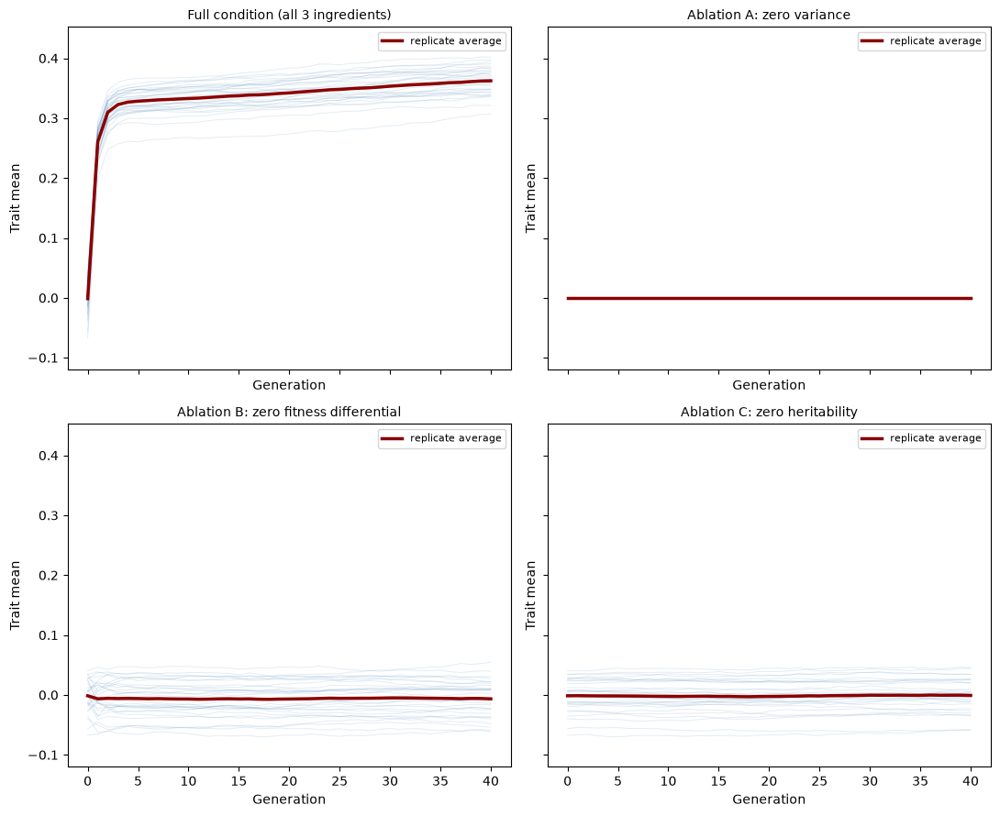
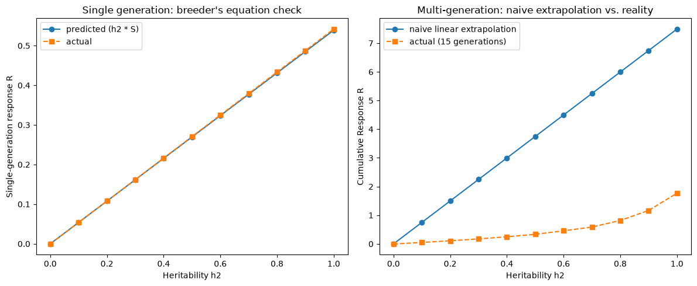

# Darwinian Selection — Which Ingredient Is Actually Necessary?

Darwin's argument for natural selection needs three things true at once: heritable variation in a trait, a
real link between that trait and reproductive success, and transmission of the trait to offspring. A minimal
individual-based simulation testing each ingredient's necessity directly — by removing exactly one at a time
— plus a real, quantified check of the classical breeder's equation and where it breaks down under sustained
selection.

## 1. Aim

Convert "natural selection requires variation, heritability, and differential fitness" from a textbook list
into a directly demonstrated, individually-tested necessity claim, rather than assuming the mechanism works
the way it's usually stated.

## 2. Objective

1. Build a minimal individual-based population model: a continuous trait, a logistic survival function
   linking trait to reproductive success, and a heritability-weighted reproduction step.
2. Confirm the full model (all three ingredients present) produces a real, statistically unambiguous
   directional shift in the population's trait mean.
3. Test three ablations — zero starting variance, zero fitness-trait link, zero heritability — each removing
   exactly one ingredient while holding the other two at the full condition's values, and confirm none of
   them produces a real directional response.
4. Check the classical breeder's equation `R = h^2 * S` against the real simulated data, both at the
   single-generation level it was derived for and across a full multi-generation heritability sweep.

## 3. Data fetch

None — and that's the right choice for this specific question: testing whether each of three mechanistic
ingredients is independently necessary requires being able to switch each one on and off exactly, something
no real population allows, since in real populations variation, heritability, and fitness-linkage are always
present (or absent) together and can't be independently controlled. The simulated individual-based population,
with its fully known and directly controllable parameters, is the real object of study here.

## 4. Data describe

Not applicable in the usual sense — the "data" is the model's own parameter space: population size `N=2000`,
starting trait variance `sigma0`, fitness-link strength `slope`, and heritability `h2`, explored across 30
replicate random seeds per condition (and 5 replicate seeds per heritability-sweep value), via direct
individual-based simulation and linear-regression significance testing.

## 5. Methods / Workflow

1. Implement a logistic survival function linking trait value to survival probability, and a single
   generation's selection-then-reproduction step using a parent-offspring regression formulation of
   heritability (`z_offspring = mu_pre + h2*(z_parent - mu_pre) + noise`, regressing to the *current*
   generation's own pre-selection mean, not a fixed ancestral one).
2. Run the full condition (variation, fitness-link, and heritability all present) across 30 replicate seeds,
   40 generations each; fit a linear regression of trait mean vs. generation per replicate.
3. Run three ablations under matched parameters: zero starting variance (with environmental noise also set
   to zero, to keep it a true null), zero fitness-trait link, and zero heritability.
4. For each condition, report the fraction of replicates with a statistically significant positive trend and
   the fraction with a significant negative trend separately, rather than one lumped "significant" number —
   a trajectory where each generation depends on the last behaves somewhat like a random walk, which inflates
   naive single-replicate significance rates; checking whether significant results are lopsided in one
   direction or roughly balanced between both is the test that's actually robust to that inflation.
5. Check the breeder's equation against one real simulated generation (measured selection differential `S`,
   predicted vs. actual response `R`).
6. Sweep heritability continuously across 11 values; compare the single-generation prediction (expected to
   match closely) against a naive multi-generation linear extrapolation vs. the real simulated cumulative
   response (expected to diverge).
7. Export all trajectories, the ablation summary, and the heritability-sweep table as CSV; plot the hero
   four-panel comparison and the sweep comparison figures.

## 6. Results

**Full condition vs. the three ablations (30 replicates each):** the full condition's trait mean rose from
~0.00 to 0.36 over 40 generations, with 100% of replicates (30/30) reaching a statistically significant
positive trend and 0% reaching a significant negative one. Each ablation showed a mean total shift
indistinguishable from zero (`-0.005` for zero fitness-link, `+0.0006` for zero heritability, and an *exact*
`0.0` for zero variance), and the two ablations that retained any noise source showed a roughly even split
between significant-positive and significant-negative replicates (33%/37% and 40%/33% respectively) — the
signature of undirected statistical noise, not a real, merely-weaker response.

**Breeder's equation, single generation:** measured selection differential `S = 0.55172`; predicted response
`h2*S = 0.27586`; actual measured response `R = 0.26889` — a `2.53%` relative error.

**Breeder's equation, multi-generation sweep:** the single-generation prediction tracked the real measured
response closely across the full heritability range tested. The naive multi-generation extrapolation (simply
scaling the single-generation prediction by the number of generations) diverged sharply from the real
cumulative response, especially at high heritability: at `h2=1.0`, the naive extrapolation predicted a
cumulative response of `7.49`, while the real simulated outcome was `1.77` — more than a 4x overestimate.
The population's trait variance collapsed to as little as `0.25%` of its starting value at low heritability,
and still only `27.8%` at `h2=1.0`, after just 15 generations.

Full results: [`results/ablation_summary.csv`](results/ablation_summary.csv),
[`results/heritability_sweep.csv`](results/heritability_sweep.csv).

## 7. Biology interpretation of results

A trait correlating with survival is not, on its own, enough to produce evolutionary change — this project's
ablations make that precise rather than qualitative. With the trait-survival link intact but heritability
removed, each new generation effectively starts over from the same pre-selection distribution, because
nothing about which individuals survived is transmitted forward. With heritability and variation intact but
no real fitness-trait link, there's no systematic basis for differential reproduction in the first place, so
any apparent trend is just sampling noise. With a real fitness link and heritability but no starting
variation, there's no raw material — no range of trait values — for selection to act among. Only when all
three conditions hold together does a real, sustained, statistically unambiguous shift appear.

The variance-erosion finding from the heritability sweep is the sharper, less commonly appreciated result: a
population under strong, sustained directional selection doesn't just approach a new optimum at a roughly
constant rate — it approaches a state with progressively less variation left for selection to act on, because
selection directly consumes the same variance that the selection differential (and therefore the response)
depends on. This is a purely statistical, self-limiting effect, distinct from any biological ceiling like a
fitness trade-off, and it directly explains why real breeding programs and conservation-genetics work both
have to account for selection-response plateaus and the erosion of additive genetic variance under sustained
selection pressure.

## 8. Learning through project

A verbal list of "necessary conditions" is a genuinely testable scientific claim, not just a mnemonic to
memorize — building the mechanism directly and removing one ingredient at a time, while holding the other two
numerically fixed, is a stronger and more concrete form of evidence than citing the textbook statement, since
it could actually have come out differently and would have shown it. Separately: a statistical significance
test applied many times to a serially-correlated (non-independent) trajectory can produce a badly miscalibrated
raw "fraction significant" number even when nothing about the underlying model is wrong — the fix isn't to
distrust the simulation, it's to ask a more targeted question of the same data (here, directional consistency
across independent replicates, not raw significance count). And a formula correctly derived for a single step
doesn't automatically stay valid when applied repeatedly, if the quantity it depends on is itself changing as
a direct consequence of the process the formula describes — checking that a formula's own assumptions still
hold before extrapolating it is a general habit, not a one-off correction specific to this project.

## 9. Caveats

A single continuous trait with a simplified scalar heritability parameter, not an explicit multi-locus
genetic architecture — real heritability emerges from many individual loci, and this project's "set
heritability directly" approach is a deliberate simplification appropriate to its foundational, minimal role,
not a claim that heritability has no underlying genetic basis. Reproduction is asexual/clonal-with-blending,
not explicit two-parent mating, sidestepping mate-choice and midparent-averaging effects a sexual model would
introduce. The logistic fitness function and its specific parameters are one deliberately simple choice among
many possible selection shapes (e.g. stabilizing rather than directional selection could produce
qualitatively different dynamics) — named explicitly as a real, disclosed scope boundary, not covered by this
build's specific numbers. A natural stretch direction: adding a second, genetically-correlated trait to test
whether selection on one trait produces a correlated, not individually intended, shift in the other — a
concrete demonstration of indirect selection this single-trait model doesn't cover.
